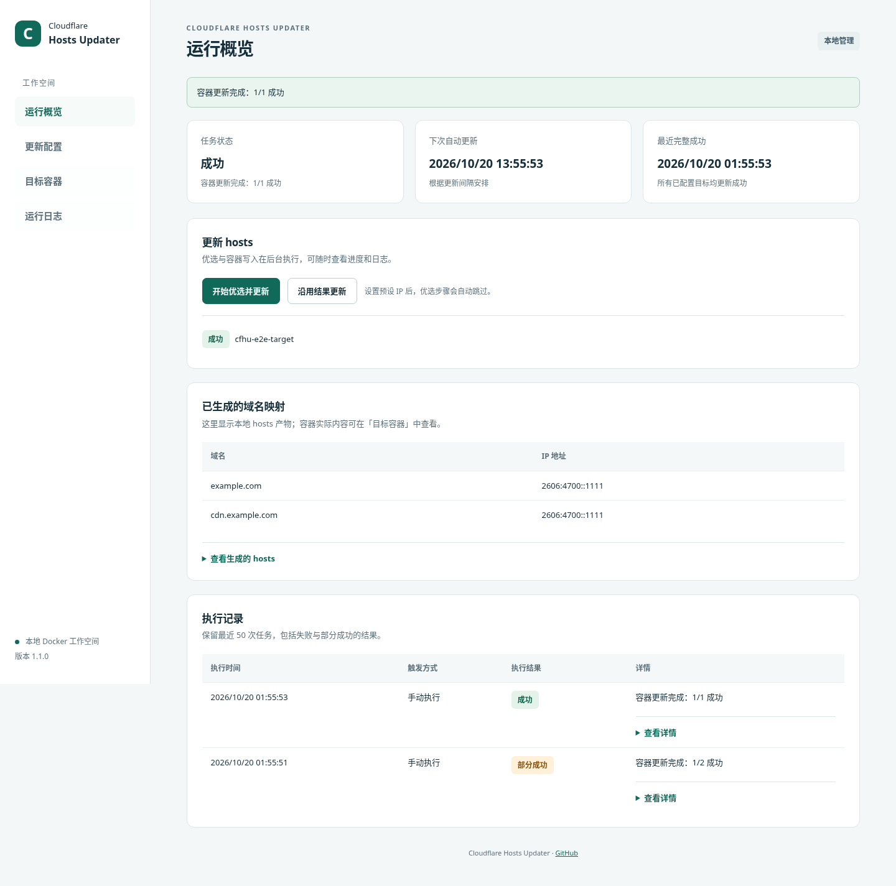

# Cloudflare Hosts Updater

为 Docker 容器优选 Cloudflare IP 并更新 hosts。提供中文界面、定时任务和逐容器执行结果。



## 快速开始

需要 Docker、Docker Compose、curl 和 tar。应用会访问同一 Docker 环境中的目标容器。

```bash
mkdir -p cloudflare-hosts-updater
cd cloudflare-hosts-updater
curl -fsSL https://github.com/neilforest7/cloudflare-hosts-updater/archive/refs/heads/main.tar.gz \
  | tar -xz --strip-components=1
docker compose up -d --build
```

这会下载源码压缩包并构建本地镜像，无需安装 Git。打开 [http://127.0.0.1:18080](http://127.0.0.1:18080)。Compose 构建适用于 amd64 和 arm64；amd64 也可直接使用 Docker Hub 的 [`1.1.0` 镜像](https://hub.docker.com/r/neilforest/cloudflare-hosts-updater/tags)。

## 首次使用

1. 勾选要更新的运行中容器。
2. 输入域名，每行一个；也可以粘贴完整网址。
3. 点击「保存并更新」，稍后在总览查看每个容器的结果。

默认每 12 小时自动更新。固定 IP、测速参数、手动填写容器和 hosts 导出选项都在「高级选项」中。

「仅保存」不会更新容器；需要立即执行时，使用「保存并更新」或总览中的「立即更新」。

## 安全与数据

默认只允许从 Docker 宿主机本地访问。管理界面使用 Docker Socket，具有控制宿主机容器的权限；请勿直接暴露到公网。远程访问前设置密码并配置 HTTPS 反向代理，详见[部署与配置](docs/configuration.md)。

配置、历史和生成的 hosts 默认保存在项目的 `./data` 目录。升级时保留这个目录；如果原部署使用自定义路径或命名卷，继续使用原来的挂载。

## 从 1.0.x 升级

1. 停止旧更新器并备份数据目录，避免两个版本同时写入容器。
2. 在项目目录获取新版代码并重建：

   ```bash
   git pull
   docker compose up -d --build
   ```

3. 确认仍挂载原来的数据目录，检查配置与历史，然后手动运行一次更新。

新版兼容旧配置、模板、测速结果、历史记录和 hosts 标记。配置损坏或不合法时会明确报错，不会静默恢复默认值。更多选项、文件说明和排查方法见[部署与配置](docs/configuration.md)。

## 开发与验证

本地测试、浏览器验证和 CI 检查见[验证记录](docs/verification.md)。Docker Hub 的预构建镜像目前只支持 amd64。

测速依赖 [XIU2/CloudflareSpeedTest](https://github.com/XIU2/CloudflareSpeedTest)，固定使用 v2.3.5。应用采用 [MIT 许可证](LICENSE)。
