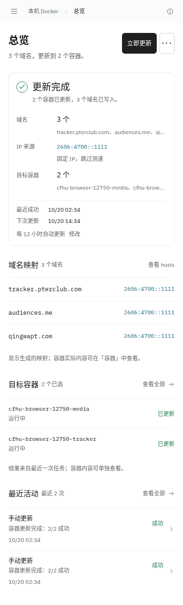
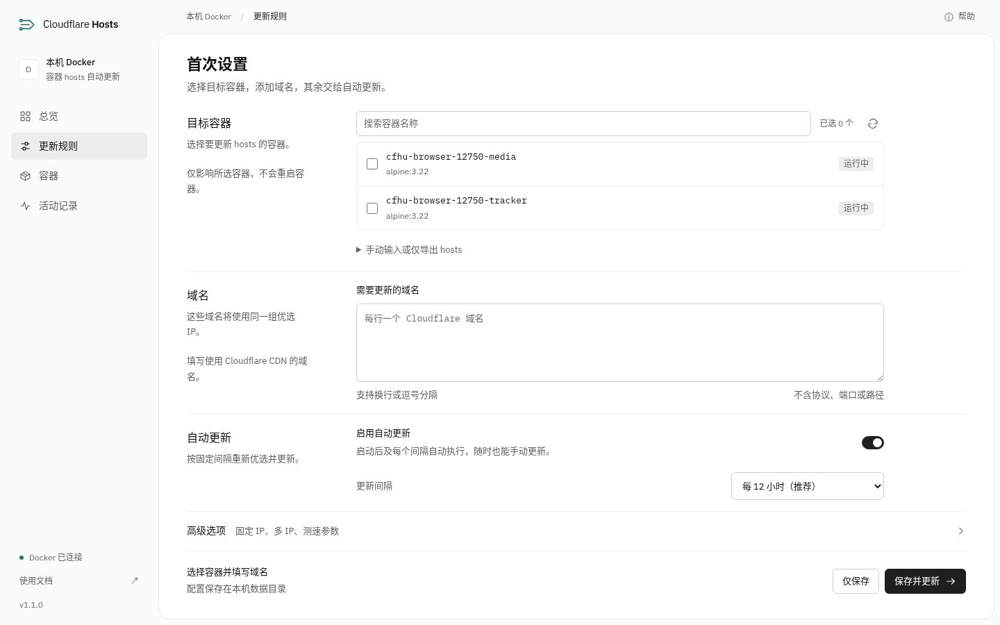

# 1.1 本地验证记录

验证流程：浏览器配置域名和容器 → API 保存配置 → 后台任务 → Docker 写入 → 网页展示实际执行结果。

## 已验证

| 检查 | 结果与证据 |
| --- | --- |
| 自动化测试 | `RUN_DOCKER_TESTS=1 pytest -q`：68 passed，包含容器发现、实际 Docker 写入与 API 错误反馈 |
| 代码检查 | `ruff check .`、`ruff format --check .`、`git diff --check`、`node --check app/static/app.js` 通过 |
| Compose | `docker compose config --quiet` 通过 |
| amd64 镜像 | 实际构建成功，Python 3.13 / Waitress 启动成功，Docker 健康状态 healthy |
| 测速工具 | 容器内二进制可启动并报告 v2.3.5；amd64 / arm64 发布包 SHA-256 校验通过 |
| 首次使用 | 空配置直接进入设置；勾选容器、填写域名、「保存并更新」后自动显示任务结果 |
| 简化输入 | 支持搜索与勾选容器、从完整网址提取域名；固定 IP 模式隐藏无关测速字段 |
| 部分成功 | 一个有效容器和一个不存在的容器产生 `partial`，网页显示逐目标结果 |
| 参数错误 | 提交无效预设 IP 返回 400，已保存配置保持不变 |
| IPv6 与保留原条目 | 网页执行后，实际容器 hosts 包含 IPv6 映射，localhost 及原容器条目仍在 |
| 持久化 | 刷新页面后配置和历史保留；重建服务实例后历史状态可读取 |
| 模板内容 | 真实容器测试验证模板中的引号及 `$()` 字符串保持字面内容，没有执行 |
| 桌面、平板与手机 | Playwright 在 1440 / 768 / 390px 下走通操作；页面与 hosts 预览无横向溢出 |
| 自动可访问性扫描 | axe-core 在三种宽度的四个视图中，WCAG 2 A/AA 与 2.1 AA 规则未发现违规，共 12 个检查组合 |
| 键盘与状态保留 | 字段错误定位、勾选焦点、详情展开、Escape 关闭与返回焦点通过；后台刷新保留当前输入与最近结果 |
| 故障恢复 | 容器发现 API 失败时提供重试和手动输入，连接恢复后可继续；状态接口断线时保留上次结果 |
| taste-skill | `Framed sheet` 方向，真实 Chromium inspector 覆盖四页与三种宽度，均无 FAIL；启发式提示的取舍见界面设计说明 |

浏览器测试中主动提交了一次非法 IP，其 400 响应用于验证错误提示；未发现 JavaScript 执行错误。

浏览器测试已保存在 `tests/browser/verify.cjs`，自动建立临时服务和自己的容器，结束后清理，并在 CI 中运行。静态字体随应用提供，不依赖浏览器访问外部 CDN。

## 验证范围

端到端容器写入使用预设 IPv4 / IPv6，不运行实际网络优选。测速子进程、超时、CSV 校验、缓存保护与相对路径通过自动化测试验证；不同真实网络下的优选质量仍需在部署环境检查。

本地执行器为 amd64，未运行 arm64 容器。CI 已配置 QEMU 构建两种架构，arm64 的设备运行情况仍需后续验证。自动可访问性扫描也不能替代人工辅助技术测试。

桌面预览：

手机预览：

首次设置：

